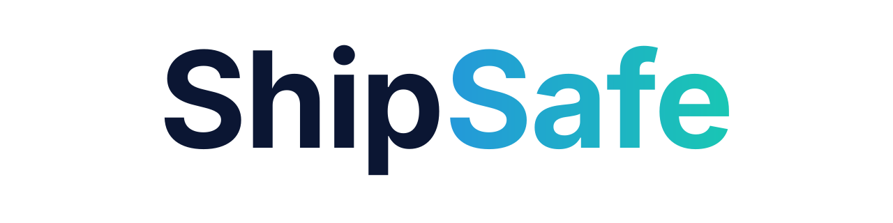

# ShipSafe

  

  <strong>Build fast. Audit deeply. Ship securely.</strong>

  An open-source application security knowledge base and toolkit for developers.

  <a href="https://github.com/axomiyaindie/shipsafe">GitHub Repository</a> ·
  <a href="SECURITY.md">Security Policy</a> ·
  <a href="CONTRIBUTING.md">Contributing</a>

---

## About ShipSafe

ShipSafe is an open-source application security knowledge base and toolkit that helps developers identify, understand, prevent, and remediate security vulnerabilities throughout the software development lifecycle.

It provides practical security documentation, implementation guidance, review checklists, and educational resources covering modern application development.

ShipSafe is designed for:

- AI-assisted development and vibe coding.
- Traditional software engineering.
- Web and mobile application development.
- Backend and API engineering.
- Cloud infrastructure and deployment.
- Indie developers, startups, and engineering teams.

The goal is simple: help developers think about security before shipping software, not only after something goes wrong.

## Mission

Make application security accessible, practical, and actionable for every developer.

ShipSafe aims to make security an integral part of building software by providing understandable guidance, actionable recommendations, and practical review processes.

## What ShipSafe Covers

| Security Domain | Coverage |
|---|---|
| Authentication | Passwords, MFA, OAuth, OIDC, sessions, and account security |
| Authorization | Access control, RBAC, ABAC, IDOR, BOLA, and privilege escalation |
| API Security | REST, GraphQL, API vulnerabilities, rate limiting, and secure integrations |
| Database Security | SQL and NoSQL injection, database permissions, RLS, and data isolation |
| Web Security | XSS, CSRF, CSP, CORS, SSRF, file uploads, and browser security |
| Mobile Security | Android, iOS, Flutter, React Native, secure storage, and mobile testing |
| Secrets Management | API keys, tokens, environment variables, secret storage, and rotation |
| Dependency Security | Vulnerable packages, supply-chain risks, dependency auditing, and SBOMs |
| Infrastructure Security | Linux, servers, networking, containers, deployment, and hardening |
| Cloud Security | AWS, Azure, GCP, IAM, storage, cloud workloads, and configuration |
| Threat Modeling | Assets, attack surfaces, trust boundaries, STRIDE, and risk assessment |
| Secure Development | Secure coding, SSDLC, code review, and AI-generated code security |
| Security Testing | SAST, DAST, SCA, penetration testing, and vulnerability validation |
| Cryptography | Encryption, hashing, signatures, key management, and secure protocols |
| Privacy and Data Protection | Data minimization, consent, retention, privacy controls, and compliance considerations |
| Logging and Monitoring | Security events, alerting, audit trails, and incident investigation |
| Incident Response | Detection, containment, eradication, recovery, and security incident handling |

## Explore the Repository

| Resource | Description |
|---|---|
| [Project Structure](STRUCTURE.md) | Complete repository architecture and the purpose of every directory and file. |
| [Security Knowledge Base](security/) | Security concepts, vulnerabilities, prevention techniques, and remediation guidance. |
| [Security Checklists](checklists/) | Practical security reviews for web, mobile, APIs, and production releases. |
| [Documentation](docs/) | Project documentation, standards, and developer guides. |
| [Code Examples](examples/) | Secure implementation examples and reference material. |
| [Security Tools](tools/) | Security utilities, recommended developer tools, and future tooling resources. |
| [Contributing Guidelines](CONTRIBUTING.md) | How to contribute to ShipSafe. |
| [Security Policy](SECURITY.md) | How to responsibly report security vulnerabilities affecting ShipSafe. |
| [Code of Conduct](CODE_OF_CONDUCT.md) | Community participation and collaboration standards. |
| [Software License](LICENSE) | MIT License for software, scripts, and identified code examples. |
| [Documentation License](LICENSE-DOCUMENTATION) | CC BY 4.0 for written documentation and educational content. |

## Security Checklists

ShipSafe includes practical checklists to help developers review common security requirements.

| Checklist | Purpose |
|---|---|
| [Web Application Checklist](checklists/web-app.md) | Review web application security controls and common vulnerabilities. |
| [API Security Checklist](checklists/api.md) | Review API authentication, authorization, validation, and exposure risks. |
| [Mobile Application Checklist](checklists/mobile-app.md) | Review Android and iOS application security. |
| [Pre-Launch Checklist](checklists/pre-launch.md) | Perform a security review before production deployment. |

These checklists are intended to support security reviews. Completing them does not guarantee that an application is secure.

## Who Is ShipSafe For?

ShipSafe is intended for anyone involved in designing, building, deploying, or maintaining software.

- Indie developers and solo founders.
- AI-assisted developers and vibe coders.
- Frontend and backend engineers.
- Web and mobile application developers.
- Open-source maintainers.
- Startups and engineering teams.
- Security researchers and students.
- DevOps and cloud engineers.
- Technical educators and development communities.

No advanced cybersecurity background is required to start exploring the knowledge base.

## Core Principles

1. **Security from the beginning:** Security should be part of the development lifecycle, not an afterthought.
2. **Practical guidance:** Recommendations should be actionable and informed by established security standards.
3. **Secure by default:** Promote implementation patterns that minimize unnecessary exposure and excessive privileges.
4. **Understandable security:** Explain vulnerabilities, their impact, and practical remediation.
5. **Technology agnostic:** Provide broadly applicable knowledge alongside stack-specific examples.
6. **Responsible development:** Encourage authorized testing, responsible disclosure, and privacy protection.
7. **Open collaboration:** Improve application security through shared knowledge and community contributions.

## How to Use ShipSafe

A recommended workflow:

1. Explore the security domain relevant to your application.
2. Understand the risks affecting your architecture and technology stack.
3. Review the corresponding security checklist.
4. Apply appropriate prevention and remediation practices.
5. Test security controls and document findings.
6. Complete the pre-launch security review before production deployment.
7. Continue monitoring and reviewing security after release.

**New to ShipSafe?** Start with the [Security Knowledge Base](security/) or the [Production Pre-Launch Checklist](checklists/pre-launch.md).

## ShipSafe and AI-Assisted Development

AI coding assistants can accelerate software development, but generated code is not automatically secure.

ShipSafe encourages developers to review AI-generated implementations for:

- Authentication and authorization weaknesses.
- Insecure API endpoints and data exposure.
- Hardcoded credentials and exposed secrets.
- Injection vulnerabilities and unsafe input handling.
- Insecure database access and missing data isolation.
- Vulnerable dependencies and unsafe package usage.
- Insecure file uploads and external integrations.
- Missing security tests and incomplete error handling.

AI-generated code should be treated like any other code: reviewed, tested, and validated before deployment.

## Project Scope and Development Status

ShipSafe currently provides:

- Security documentation and educational guides.
- Application security checklists.
- Secure development recommendations.
- Vulnerability prevention and remediation guidance.
- Repository contribution and security policies.
- Reference material for developers and security practitioners.

**Important:** The current repository is primarily a documentation and knowledge-base project. Its presence does not imply that a security scanner, automated auditing engine, vulnerability detection service, or production security platform has been implemented.

Future software and automation capabilities will be documented according to their actual implementation, supported checks, limitations, and testing requirements.

## Contributing

ShipSafe is community-driven. Contributions from developers, security researchers, technical writers, students, and open-source enthusiasts are welcome.

You can contribute by:

- Improving existing security documentation.
- Researching and documenting vulnerabilities.
- Adding practical security checklists.
- Contributing secure code examples.
- Reviewing technical accuracy.
- Suggesting improvements and new security topics.
- Reporting documentation errors.
- Improving repository organization.

Before contributing, please read:

- [Contributing Guidelines](CONTRIBUTING.md)
- [Code of Conduct](CODE_OF_CONDUCT.md)

## Security Reporting

If you discover a security issue affecting ShipSafe itself, please follow the instructions in our [Security Policy](SECURITY.md).

Do not publish sensitive vulnerability details, credentials, access tokens, or private information in public issues.

For general security documentation improvements, use the repository's normal contribution process.

## Disclaimer

ShipSafe is an educational and developer-support project.

Its documentation, checklists, examples, and any future automated tools cannot guarantee application security or replace professional security assessments.

Security requirements depend on an application's architecture, implementation, threat model, deployment environment, dependencies, and risk profile.

Always perform appropriate security reviews and authorized testing before production deployment.

## Licensing

ShipSafe follows a dual-licensing model.

| Content | License |
|---|---|
| Written documentation, educational guides, and checklists | [Creative Commons Attribution 4.0 International (CC BY 4.0)](LICENSE-DOCUMENTATION) |
| Software, scripts, and code examples explicitly identified as MIT-licensed | [MIT License](LICENSE) |

Third-party materials remain subject to their respective licenses and attribution requirements.

When reusing ShipSafe content, check the relevant file's license notice and preserve all required attribution.

---

  <strong>Build fast. Audit deeply. Ship securely.</strong>

  Open knowledge. Better security. Safer software.

