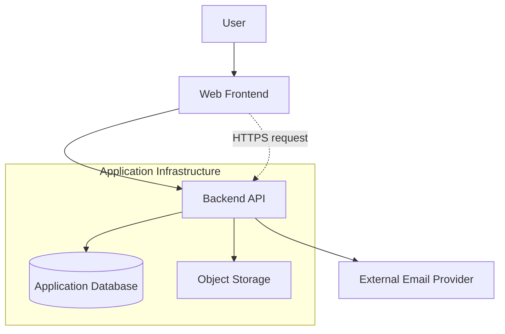
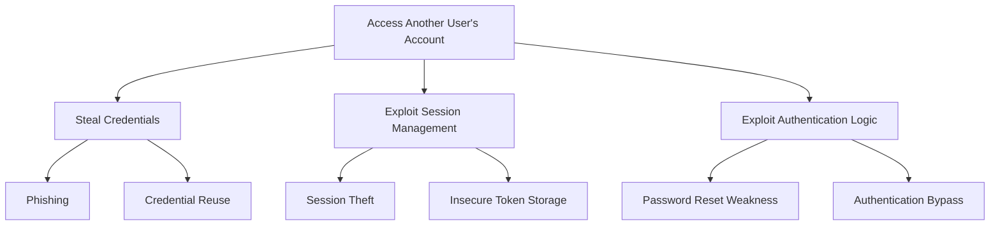

# Threat Modeling

Threat modeling is a structured process for identifying, understanding, evaluating and reducing security risks before they become vulnerabilities.

It helps developers understand what they are building, what can go wrong, how attackers might exploit weaknesses and which security controls should be implemented.

Threat modeling should be part of application design, development, deployment and ongoing maintenance.

This guide introduces practical threat modeling methods for web applications, mobile applications, APIs, backend services, cloud infrastructure and AI-assisted software development.

## 1. What Is Threat Modeling?

Threat modeling is the process of examining an application or system from a security perspective.

It helps answer five important questions:

1. What are we building?
2. What assets need protection?
3. Who or what could attack the system?
4. How could an attack happen?
5. What can we do to prevent or reduce the risk?

Threat modeling does not require an application to be fully implemented. It is often most valuable during the planning and architecture stages.

### Why Threat Modeling Matters

Without threat modeling, development teams may overlook:

- Unauthorized access to sensitive information.
- Broken authentication and authorization.
- Insecure API endpoints.
- Cross-tenant data exposure.
- Privilege escalation.
- Insecure file uploads.
- Exposed credentials.
- Insecure integrations.
- Weak infrastructure boundaries.
- Abuse of legitimate application functionality.

Identifying these risks early generally makes them easier and less expensive to address.

## 2. Core Threat Modeling Concepts

Understanding the following terms makes threat modeling easier.

| Term | Meaning |
|---|---|
| Asset | Something valuable that requires protection |
| Threat | A potential cause of harm to a system |
| Threat actor | A person or entity that may carry out an attack |
| Attack surface | Points through which a system can be accessed or influenced |
| Attack vector | A method used to carry out an attack |
| Vulnerability | A weakness that can be exploited |
| Security control | A measure that prevents, detects or reduces risk |
| Risk | The potential impact and likelihood of a harmful event |
| Trust boundary | A boundary between components with different trust levels |
| Mitigation | An action that reduces a security risk |

### Threat vs. Vulnerability vs. Risk

These terms are related but different.

**Threat:** An attacker attempts to access another user's private account.

**Vulnerability:** The application does not properly verify ownership of the requested account.

**Risk:** An attacker could access private information belonging to other users.

A threat model connects these concepts and helps determine appropriate security controls.

## 3. Identify Assets

Start by identifying what the application needs to protect.

Assets can include data, infrastructure, credentials, business processes and user accounts.

### Common Application Assets

- User accounts.
- Passwords and authentication tokens.
- Personal information.
- Payment information.
- Private documents.
- Application databases.
- API credentials.
- Administrative accounts.
- Source code.
- Cloud resources.
- Backups.
- Internal APIs.
- Business-critical operations.

### Asset Classification

Classify assets according to their sensitivity and business importance.

| Classification | Example | Protection requirement |
|---|---|---|
| Public | Public marketing content | Integrity and availability |
| Internal | Internal documentation | Restricted access |
| Confidential | User information | Strong access control |
| Highly sensitive | Authentication secrets | Strict access and protection |

The classification system should reflect the organization's actual data handling requirements.

### Asset Inventory Questions

- What information does the application collect?
- Where is the information stored?
- Which components process it?
- Who can access it?
- Which external services receive it?
- How long is it retained?
- What happens if it is exposed or modified?

## 4. Identify Threat Actors

A threat actor is a person or entity capable of causing harm to a system.

Not every threat actor has the same objectives, resources or capabilities.

### Common Threat Actors

**Unauthenticated attackers**

Attempt to exploit publicly accessible application functionality without an account.

**Authenticated users**

May attempt to access information or functionality beyond their permissions.

**Malicious insiders**

May misuse legitimate access to obtain or disclose information.

**Compromised accounts**

Attackers may take control of legitimate user or administrator accounts.

**Automated bots**

May perform credential stuffing, scraping, spam, enumeration and other automated attacks.

**Malicious third parties**

Compromised dependencies, service providers or integrations may introduce security risks.

**Nation-state or highly capable attackers**

May have significant resources and target valuable infrastructure or sensitive information.

### Threat Actor Questions

- What access does the attacker already have?
- Can the attacker create an account?
- Can the attacker control their own client?
- Can they send arbitrary API requests?
- Can they manipulate uploaded files?
- Can they influence third-party integrations?
- What information or functionality might they target?

Do not assume that an authenticated user is trustworthy.

## 5. Map the Application Architecture

Before identifying individual threats, understand how the application works.

Document the major components and how information moves between them.

### Example Application Components

- Web frontend.
- Mobile application.
- Backend API.
- Authentication service.
- Database.
- Object storage.
- Payment provider.
- Email provider.
- Background workers.
- Cloud infrastructure.
- Monitoring services.

### Architecture Questions

- Which components are publicly accessible?
- Which components communicate internally?
- Where does authentication happen?
- Where is authorization enforced?
- Which components store sensitive information?
- Which third-party services receive data?
- Which services have administrative privileges?

The objective is to understand the system's actual trust relationships.

## 6. Data Flow Diagrams

A Data Flow Diagram (DFD) illustrates how information moves through an application.

DFDs are useful for identifying security boundaries and potential attack paths.

### Common DFD Elements

| Element | Description |
|---|---|
| External entity | A user or external system |
| Process | A component that handles or transforms data |
| Data store | A database, file store or other persistent storage |
| Data flow | Information moving between components |
| Trust boundary | A boundary separating different trust levels |

### Example: Basic Web Application



This diagram is illustrative. A real threat model should identify the actual communication paths, identities and trust boundaries.

### Data Flow Review

For each connection, document:

- What information is transmitted?
- Which component sends it?
- Which component receives it?
- Is the communication encrypted?
- Is the sender authenticated?
- Is the receiver authorized to access the data?
- Can the data be modified?
- Is the information logged?
- Does the connection cross a trust boundary?

### Important Principle

Every time data crosses a trust boundary, evaluate the authentication, authorization, validation and protection requirements.

## 7. Trust Boundaries

A trust boundary separates components that operate under different trust assumptions.

### Common Trust Boundaries

- User device to frontend.
- Frontend to backend API.
- Backend to database.
- Application to third-party service.
- Public network to private network.
- Tenant A to Tenant B.
- Development environment to production.
- Container to host operating system.

### Example

A browser is controlled by the user. Therefore, values received from the browser must not be trusted simply because they were generated by your own frontend.

The backend should independently validate:

- User identity.
- Requested operation.
- Resource ownership.
- Input data.
- Permission requirements.

Never rely exclusively on frontend validation for security.

## 8. STRIDE Threat Modeling

STRIDE is a threat classification methodology originally developed by Microsoft.

It helps teams systematically identify common categories of security threats.

STRIDE represents six threat categories.

### S — Spoofing

An attacker pretends to be another user, service or system.

Examples:

- Stolen session tokens.
- Forged authentication credentials.
- Impersonation of internal services.
- Compromised API credentials.

Possible mitigations:

- Strong authentication.
- MFA.
- Secure session management.
- Credential protection.
- Service identity verification.
- Appropriate token validation.

### T — Tampering

An attacker modifies data or system behavior without authorization.

Examples:

- Changing account ownership fields.
- Modifying payment amounts.
- Altering API requests.
- Manipulating stored records.
- Modifying deployment configuration.

Possible mitigations:

- Server-side validation.
- Authorization checks.
- Integrity verification.
- Secure configuration management.
- Database constraints.
- Protected audit trails.

### R — Repudiation

An actor denies performing an action because reliable evidence is missing.

Examples:

- A user denies changing account settings.
- An administrator denies deleting records.
- A payment action has no traceable audit event.

Possible mitigations:

- Appropriate audit logging.
- Reliable timestamps.
- Protected log storage.
- Traceable transaction identifiers.
- Defined retention policies.

Logging should avoid exposing passwords, access tokens and unnecessary sensitive information.

### I — Information Disclosure

Sensitive information is exposed to unauthorized parties.

Examples:

- Broken object-level authorization.
- Public database backups.
- Exposed API responses.
- Insecure storage permissions.
- Debug information in production.
- Leaked credentials.

Possible mitigations:

- Access control.
- Data minimization.
- Encryption where appropriate.
- Secure storage configuration.
- Error response sanitization.
- Secret management.
- Secure logging.

### D — Denial of Service

An attacker makes a service unavailable or degrades its performance.

Examples:

- Excessive API requests.
- Resource-intensive search queries.
- Unrestricted file uploads.
- Expensive database operations.
- Application-layer request floods.

Possible mitigations:

- Rate limiting.
- Resource limits.
- Request size restrictions.
- Query optimization.
- Traffic filtering.
- Autoscaling with appropriate limits.
- Abuse monitoring.

### E — Elevation of Privilege

An attacker gains permissions beyond their intended access.

Examples:

- A normal user accesses administrator functionality.
- A tenant accesses another tenant's records.
- An API user invokes privileged operations.
- A compromised service account gains excessive permissions.

Possible mitigations:

- Server-side authorization.
- Least privilege.
- Role and permission validation.
- Resource ownership checks.
- Privileged action monitoring.
- Secure service account configuration.

### STRIDE Summary

| Category | Security property affected | Example |
|---|---|---|
| Spoofing | Authentication | Account impersonation |
| Tampering | Integrity | Unauthorized record modification |
| Repudiation | Accountability | Missing audit evidence |
| Information Disclosure | Confidentiality | Private data exposure |
| Denial of Service | Availability | Resource exhaustion |
| Elevation of Privilege | Authorization | Unauthorized admin access |

STRIDE helps identify threats. It does not automatically calculate their severity or guarantee that all possible threats have been discovered.

## 9. Attack Surface Analysis

Attack surface analysis identifies the entry points available to potential attackers.

### Web Application Attack Surface

- Login and registration.
- Password recovery.
- Search endpoints.
- File uploads.
- User-generated content.
- Administrative dashboards.
- Public API endpoints.
- Third-party scripts.
- Redirect functionality.
- Webhooks.

### Mobile Application Attack Surface

- Deep links.
- Local storage.
- Application permissions.
- WebViews.
- Network communication.
- Authentication tokens.
- Exported Android components.
- Inter-app communication.
- Third-party SDKs.

### API Attack Surface

- Authentication endpoints.
- Resource identifiers.
- Administrative endpoints.
- Search and filtering parameters.
- Pagination.
- File handling.
- Webhooks.
- GraphQL queries and mutations.
- Rate-sensitive operations.

### Infrastructure Attack Surface

- SSH.
- Remote administration.
- Public ports.
- Cloud management interfaces.
- Container management.
- Storage services.
- CI/CD systems.
- DNS and domain management.

For every entry point, identify the expected authentication, authorization, validation and abuse protections.

## 10. Attack Trees

An attack tree represents how an attacker could achieve a particular objective through different attack paths.

### Example: Access Another User's Account



### How to Build an Attack Tree

1. Define the attacker's objective.
2. Identify possible high-level attack paths.
3. Break each path into smaller actions.
4. Identify the conditions required for each action.
5. Identify existing security controls.
6. Document remaining risks.
7. Prioritize appropriate mitigations.

Attack trees are models of possible attack paths, not proof that those attacks are exploitable.

## 11. Risk Assessment and Prioritization

Not every identified threat deserves the same priority.

Risk assessment helps determine which problems require immediate attention.

### Risk Assessment Factors

- Likelihood of exploitation.
- Potential impact.
- Exposure of the affected component.
- Sensitivity of affected information.
- Required attacker privileges.
- Availability of existing controls.
- Business and operational consequences.

### Example Risk Matrix

| Likelihood | Impact | General priority |
|---|---|---|
| High | Critical | Critical |
| High | Medium | High |
| Medium | High | High |
| Medium | Medium | Medium |
| Low | Low | Low |

This is an illustrative matrix. Teams should define consistent scoring criteria for their environment.

### Simple Risk Scoring

One basic model is:

Risk Score = Likelihood × Impact

For example, using scores from 1 to 5:

| Likelihood | Impact | Score |
|---:|---:|---:|
| 5 | 5 | 25 |
| 4 | 4 | 16 |
| 3 | 3 | 9 |
| 2 | 2 | 4 |
| 1 | 1 | 1 |

This is a prioritization aid, not a universal security standard.

### Risk Treatment Options

- **Mitigate:** Implement controls to reduce risk.
- **Avoid:** Change the design or remove the risky functionality.
- **Transfer:** Allocate certain financial or operational consequences through an appropriate arrangement.
- **Accept:** Formally accept a documented residual risk.

Risk acceptance should be an informed decision made by an authorized owner.

## 12. Threat Modeling for Authentication

Authentication systems protect user identity and application access.

### Threats to Consider

- Credential stuffing.
- Brute-force attacks.
- Account enumeration.
- Session theft.
- Password reset abuse.
- MFA bypass.
- Token leakage.
- Weak account recovery.
- Insecure OAuth redirects.
- Improper token validation.

### Questions to Ask

- Can attackers discover valid accounts?
- Are login attempts appropriately limited?
- Are authentication tokens protected?
- Can sessions be revoked?
- Is MFA available for sensitive accounts?
- Are password reset tokens short-lived and single-use?
- Are OAuth redirect destinations validated?
- Is account recovery protected against takeover?

### Relevant Security Guidance

- Authentication guide: `../authentication/README.md`
- Secrets management: `../secrets-management/README.md`
- OWASP Authentication Cheat Sheet: https://cheatsheetseries.owasp.org/cheatsheets/Authentication_Cheat_Sheet.html

## 13. Threat Modeling for Authorization

Authorization determines which users and services can perform specific actions on specific resources.

### Threats to Consider

- Broken object-level authorization.
- Broken function-level authorization.
- Privilege escalation.
- Cross-tenant access.
- Insecure direct object references.
- Unauthorized administrative operations.
- Missing resource ownership checks.

### Questions to Ask

- Can a user access another user's resource?
- Can a normal user invoke administrator endpoints?
- Are permissions checked on the backend?
- Are tenant boundaries enforced?
- Can resource identifiers be manipulated?
- Are background jobs subject to appropriate authorization rules?

### Relevant Security Guidance

- Authorization guide: `../authorization/README.md`
- OWASP Authorization Cheat Sheet: https://cheatsheetseries.owasp.org/cheatsheets/Authorization_Cheat_Sheet.html

## 14. Threat Modeling for APIs

APIs expose application functionality to browsers, mobile clients, integrations and other services.

### Threats to Consider

- Broken object-level authorization.
- Broken authentication.
- Excessive data exposure.
- Mass assignment.
- Injection attacks.
- Resource exhaustion.
- SSRF.
- Insecure webhooks.
- API key leakage.
- Improper CORS configuration.

### Questions to Ask

- Is every endpoint authenticated when required?
- Are resource permissions checked independently?
- Can clients request unnecessary sensitive fields?
- Are expensive operations rate-limited?
- Are request bodies validated?
- Are webhook signatures verified?
- Are internal services protected from arbitrary requests?

### Relevant Security Guidance

- API Security guide: `../api-security/README.md`
- OWASP API Security Top 10: https://owasp.org/API-Security/

## 15. Threat Modeling for Web Applications

Web applications combine browser-controlled interfaces, backend services, databases and external integrations.

### Threats to Consider

- Cross-site scripting.
- Cross-site request forgery.
- Clickjacking.
- Injection.
- Insecure session cookies.
- Open redirects.
- Server-side request forgery.
- File upload vulnerabilities.
- Exposed source maps or debug information.
- Third-party script compromise.

### Questions to Ask

- Is untrusted content safely rendered?
- Are state-changing actions protected against CSRF where applicable?
- Are security headers configured?
- Are cookies appropriately protected?
- Are redirects validated?
- Are uploads stored and served safely?
- Are third-party scripts reviewed?

### Relevant Security Guidance

- Web Security guide: `../web-security/README.md`
- OWASP Web Security Testing Guide: https://owasp.org/www-project-web-security-testing-guide/

## 16. Threat Modeling for Mobile Applications

Mobile applications operate in environments that are not fully controlled by the application developer.

Users may inspect application files, modify requests, reverse engineer binaries and operate devices with elevated privileges.

### Threats to Consider

- Sensitive data stored insecurely.
- Embedded API secrets.
- Insecure network communication.
- Token theft.
- Deep-link abuse.
- Insecure WebViews.
- Excessive application permissions.
- Reverse engineering.
- Debug builds distributed publicly.
- Vulnerable third-party SDKs.

### Questions to Ask

- What data is stored on the device?
- Are sensitive values stored using platform security facilities?
- Can users modify API requests?
- Does the backend enforce authorization?
- Are deep links validated?
- Are production builds properly signed?
- Are third-party SDKs reviewed?

### Relevant Security Guidance

- Mobile Security guide: `../mobile-security/README.md`
- OWASP MASVS: https://mas.owasp.org/MASVS/

## 17. Threat Modeling for Multi-Tenant Applications

Multi-tenant applications serve multiple customers or organizations using shared infrastructure or application services.

Tenant isolation is a critical security requirement.

### Threats to Consider

- Cross-tenant data access.
- Incorrect tenant identification.
- Missing ownership checks.
- Insecure administrative operations.
- Shared cache leakage.
- Background job tenant confusion.
- Storage bucket misconfiguration.
- Database row-level security failures.

### Questions to Ask

- How is the tenant identified?
- Can users modify tenant identifiers?
- Is tenant authorization enforced on the backend?
- Are database queries tenant-scoped?
- Are background jobs bound to the correct tenant?
- Are cached responses isolated?
- Are files protected by tenant-specific permissions?

A tenant identifier supplied by a client is not proof that the user belongs to that tenant.

### Security Controls

- Verify tenant membership server-side.
- Enforce tenant-level authorization.
- Use database isolation controls where appropriate.
- Scope storage permissions.
- Test cross-tenant access explicitly.
- Audit privileged cross-tenant operations.

## 18. Threat Modeling for AI-Assisted Development

AI coding assistants and autonomous coding agents can accelerate development, but generated code and automated changes introduce additional security considerations.

AI-generated code must be treated like code written by any other contributor: it requires review, testing and validation.

### Common Risks

- Insecure authentication implementations.
- Missing authorization checks.
- Hardcoded credentials.
- Unsafe dependency recommendations.
- Vulnerable generated code.
- Insecure SQL queries.
- Missing input validation.
- Overly permissive infrastructure configuration.
- Unreviewed changes to security-sensitive files.
- Accidental exposure of secrets in prompts or logs.

### AI Agent Threat Scenarios

**Untrusted instructions in project files**

An agent may process malicious instructions embedded in untrusted content.

**Excessive tool permissions**

An agent may have access to sensitive files, terminals, deployment credentials or production systems beyond what its task requires.

**Secret exposure**

Credentials may be included in prompts, generated logs, code or tool outputs.

**Unreviewed code changes**

Generated changes may introduce vulnerabilities even when they appear functionally correct.

**Unsafe dependency selection**

An agent may recommend or install an untrusted or compromised package.

### Security Recommendations

- Review AI-generated authentication and authorization code.
- Never provide unnecessary production credentials to agents.
- Restrict agent access to sensitive files and systems.
- Review shell commands before execution.
- Audit generated dependencies.
- Run security tests on generated code.
- Require human review for privileged operations.
- Treat external content and repository instructions as untrusted unless verified.
- Keep deployment credentials outside ordinary development workflows.

AI assistance does not replace secure engineering practices or independent security review.

## 19. Third-Party and Supply Chain Threat Modeling

Modern applications rely on external packages, APIs, SDKs, cloud services and vendors.

A compromise in one dependency or service can affect the entire application.

### Threats to Consider

- Malicious packages.
- Compromised package maintainers.
- Vulnerable SDKs.
- Exposed integration credentials.
- Insecure webhook implementations.
- Third-party service outages.
- Excessive vendor permissions.
- Untrusted build artifacts.

### Questions to Ask

- Which external services receive sensitive data?
- Which dependencies execute with application privileges?
- Are packages pinned and reviewed?
- Can third-party services access production resources?
- How are integration credentials stored?
- What happens if a provider becomes compromised?
- Can dependencies be replaced with malicious versions?

### Security Recommendations

- Maintain a software bill of materials where appropriate.
- Review dependency updates.
- Use trusted package sources.
- Restrict integration permissions.
- Protect API credentials.
- Verify webhook signatures.
- Monitor dependency vulnerabilities.
- Establish vendor security requirements.

Relevant guide: `../dependencies/README.md`

## 20. Threat Modeling for Cloud Infrastructure

Cloud infrastructure introduces risks involving identity, networking, storage, deployment and management interfaces.

### Threats to Consider

- Public storage exposure.
- Excessive IAM permissions.
- Compromised cloud credentials.
- Insecure network rules.
- Exposed management endpoints.
- Unprotected backups.
- Insecure container workloads.
- Missing audit logs.

### Questions to Ask

- Which cloud resources are publicly accessible?
- Which identities can modify production infrastructure?
- Are temporary credentials used where possible?
- Are storage permissions restricted?
- Are audit events monitored?
- Are backup systems isolated?
- Are deployment permissions limited?

Relevant guide: `../infrastructure/README.md` and `../cloud-security/README.md`

## 21. Practical Threat Modeling Workflow

Use the following workflow when reviewing a new application or major feature.

### Phase 1: Understand the System

- [ ] Describe the application's purpose.
- [ ] Identify important features.
- [ ] Document system architecture.
- [ ] Identify users and external services.
- [ ] Identify sensitive data.
- [ ] Document important infrastructure.

### Phase 2: Map Data Flows

- [ ] Identify external entities.
- [ ] Identify processes and data stores.
- [ ] Document communication paths.
- [ ] Identify trust boundaries.
- [ ] Identify publicly accessible entry points.
- [ ] Document external integrations.

### Phase 3: Identify Threats

- [ ] Identify possible threat actors.
- [ ] Review each entry point.
- [ ] Apply STRIDE where appropriate.
- [ ] Consider authentication threats.
- [ ] Consider authorization threats.
- [ ] Consider data exposure.
- [ ] Consider service disruption.
- [ ] Consider supply chain threats.

### Phase 4: Assess Risk

- [ ] Document each threat scenario.
- [ ] Identify affected assets.
- [ ] Estimate likelihood.
- [ ] Estimate impact.
- [ ] Identify existing controls.
- [ ] Prioritize unresolved risks.

### Phase 5: Define Mitigations

- [ ] Assign security requirements.
- [ ] Select appropriate controls.
- [ ] Assign owners.
- [ ] Define validation steps.
- [ ] Record accepted residual risks.

### Phase 6: Validate and Maintain

- [ ] Review mitigations.
- [ ] Test security assumptions.
- [ ] Update the threat model after major changes.
- [ ] Review newly introduced dependencies.
- [ ] Reassess external integrations.
- [ ] Track unresolved security risks.

## 22. Threat Model Documentation Template

Use this template for individual applications, features or architectural changes.

```markdown
# Threat Model: [Application or Feature Name]

## 1. Overview

- Application:
- Feature:
- Owner:
- Date:
- Review status:

## 2. System Description

Describe what the system does and how it works.

## 3. Assets

| Asset | Sensitivity | Location |
|---|---|---|
| | | |

## 4. Threat Actors

| Actor | Capabilities | Potential objective |
|---|---|---|
| | | |

## 5. Architecture

Document major components, integrations and data flows.

## 6. Trust Boundaries

Identify boundaries between users, services, networks and environments.

## 7. Entry Points

| Entry point | Exposure | Required protection |
|---|---|---|
| | | |

## 8. Threat Scenarios

| ID | STRIDE category | Threat | Affected asset |
|---|---|---|---|
| T-001 | | | |

## 9. Risk Assessment

| Threat ID | Likelihood | Impact | Priority |
|---|---|---|---|
| T-001 | | | |

## 10. Mitigations

| Threat ID | Security control | Owner | Validation |
|---|---|---|---|
| T-001 | | | |

## 11. Residual Risks

Document risks that remain after mitigation.

## 12. Review History

| Date | Reviewer | Changes |
|---|---|---|
| | | |
```

## 23. Example Threat Model: File Upload Feature

Consider a web application that allows authenticated users to upload documents.

### System Description

A user uploads a document through a web interface. The backend validates the request, stores the file and records its metadata in a database.

### Assets

- Uploaded documents.
- User identity.
- File metadata.
- Storage credentials.
- Database records.

### Threat Scenarios

| Threat | STRIDE category | Potential impact |
|---|---|---|
| Uploading a malicious file | Tampering | Application or user compromise |
| Accessing another user's file | Information Disclosure | Private data exposure |
| Uploading oversized files | Denial of Service | Resource exhaustion |
| Manipulating file ownership | Elevation of Privilege | Unauthorized file access |
| Forging an upload identity | Spoofing | Unauthorized uploads |
| Deleting files without permission | Tampering | Data loss |

### Recommended Controls

- Authenticate upload requests.
- Verify file ownership on every access.
- Validate file size and permitted formats.
- Inspect file contents where appropriate.
- Generate server-side storage names.
- Store uploads outside executable application paths.
- Apply appropriate storage access policies.
- Use malware scanning where justified.
- Restrict upload rates and storage quotas.
- Record security-relevant upload events.

### Validation

- Test access to another user's files.
- Test unauthorized upload requests.
- Test oversized files.
- Test misleading file extensions.
- Test malicious file content safely in an authorized environment.
- Verify storage permissions.
- Verify that deletion requires appropriate authorization.

This example is a starting point. Actual controls depend on the application's architecture and file-processing requirements.

## 24. Threat Modeling Tools

Threat modeling can be performed using diagrams, structured documents or specialized tools.

### Microsoft Threat Modeling Tool

A graphical tool for creating data flow diagrams and analyzing threats.

https://learn.microsoft.com/en-us/azure/security/develop/threat-modeling-tool

### OWASP Threat Dragon

An open-source threat modeling application.

https://owasp.org/www-project-threat-dragon/

### IriusRisk

A threat modeling platform with structured workflows.

https://iriusrisk.com/

### OWASP Cornucopia

A threat modeling card game designed to help identify application security threats.

https://owasp.org/www-project-cornucopia/

### General Diagramming Tools

- Mermaid.
- Draw.io.
- Excalidraw.
- Microsoft Visio.

Diagramming tools help represent architecture and data flows but do not automatically provide a complete threat assessment.

## 25. Common Threat Modeling Mistakes

Avoid these mistakes:

- Starting with vulnerabilities instead of understanding the system.
- Ignoring trust boundaries.
- Assuming authenticated users are trustworthy.
- Treating frontend validation as a security control.
- Ignoring third-party integrations.
- Forgetting background jobs and scheduled tasks.
- Ignoring tenant isolation.
- Treating risk scores as objective measurements.
- Recording threats without assigning mitigations.
- Creating a threat model once and never updating it.
- Assuming a tool-generated report covers every possible threat.
- Confusing theoretical attack paths with confirmed vulnerabilities.

A useful threat model should lead to actionable security improvements.

## 26. References and Further Reading

### OWASP

- [OWASP Threat Modeling](https://owasp.org/www-community/Threat_Modeling)
- [OWASP Threat Modeling Cheat Sheet](https://cheatsheetseries.owasp.org/cheatsheets/Threat_Modeling_Cheat_Sheet.html)
- [OWASP Application Security Verification Standard](https://owasp.org/www-project-application-security-verification-standard/)
- [OWASP API Security Top 10](https://owasp.org/API-Security/)

### Microsoft

- [Microsoft Threat Modeling](https://learn.microsoft.com/en-us/azure/security/develop/threat-modeling-tool)
- [Microsoft STRIDE](https://learn.microsoft.com/en-us/azure/security/develop/threat-modeling-tool-threats)

### NIST

- [NIST Cybersecurity Framework](https://www.nist.gov/cyberframework)
- [NIST SP 800-154: Guide to Data-Centric System Threat Modeling](https://csrc.nist.gov/pubs/sp/800/154/ipd)

### Additional Resources

- [OWASP Threat Dragon](https://owasp.org/www-project-threat-dragon/)
- [MITRE ATT&CK](https://attack.mitre.org/)
- [CISA Secure by Design](https://www.cisa.gov/securebydesign)

---

Threat modeling is an ongoing security activity, not a one-time checklist. This guide is educational and does not replace a professional security assessment or application-specific risk analysis.
